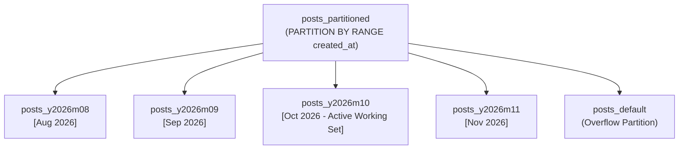

# Database Sharding & Declarative Partitioning Architecture

## 1. Problem Statement: The 10M+ Row Index Bottleneck

As the `posts` and `follows` tables scale beyond 10,000,000 rows, traditional monolithic tables encounter physical hardware boundaries:
1. **B-Tree Index RAM Eviction:** The composite index `(user_id, created_at DESC)` grows larger than the database instance's available working memory (`shared_buffers`). Every search causes disk I/O instead of hitting RAM.
2. **VACUUM Stalls:** Autovacuum locks larger tables for longer durations, causing query latency spikes.
3. **Backup / Restore Overhead:** Restoring a 500GB table takes hours, whereas restoring single monthly partitions can be parallelized.

---

## 2. Declarative Table Partitioning by Month (RANGE)

ScaleFeed employs PostgreSQL Declarative Range Partitioning partitioned by `created_at`:



### Partition Pruning with Keyset Pagination

When a client queries the feed:
```sql
SELECT * FROM posts_partitioned 
WHERE created_at < '2026-10-22 20:00:00+00' 
ORDER BY created_at DESC 
LIMIT 20;
```

PostgreSQL's Cost-Based Optimizer executes **Run-Time Partition Pruning**:
* It inspects the `WHERE created_at < ...` boundary.
* It **only scans partition `posts_y2026m10`**.
* Partitions for August, September, and previous years are completely ignored.
* **Result:** Memory usage drops by 90%, and index seek time remains $< 1\text{ms}$.

---

## 3. Azure Database for PostgreSQL Flexible Server Automation

To automate partition creation in Azure without manual DBA intervention:
1. Enable `pg_partman` and `pg_cron` extensions via the Azure Portal server parameters:
   ```sql
   CREATE EXTENSION IF NOT EXISTS pg_partman;
   CREATE EXTENSION IF NOT EXISTS pg_cron;
   ```
2. Schedule automated monthly partition creation:
   ```sql
   SELECT cron.schedule('create-new-monthly-partitions', '0 0 1 * *', 
       $$SELECT partman.run_maintenance(p_analyze := false);$$
   );
   ```
